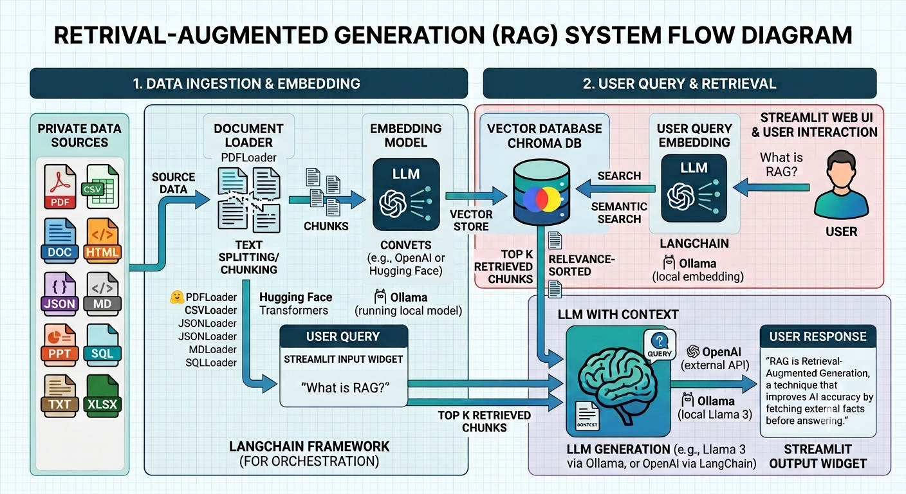

# Local RAG Project – ChromaDB, LangChain, Ollama & Streamlit

### Author: ***Naresh Padiyar***

A **local Retrieval-Augmented Generation (RAG) application** built using **LangChain, ChromaDB, Ollama, and Streamlit**.

The project enables users to interact with their **private and locally stored data** using natural-language queries, without sending sensitive information to external cloud-based AI services.

---

## Architecture Diagram



---

## 📌 Project Overview

This project implements a complete **local RAG pipeline** that allows an LLM to retrieve relevant information from private data sources before generating a response.

### RAG Pipeline

```text
Private Datasources
        │
        ▼
Document Loaders
        │
        ▼
Text Splitting / Chunking
        │
        ▼
Embedding Model
(Ollama)
        │
        ▼
ChromaDB
(Vector Database)
        │
        ▼
Similarity Search
        │
        ▼
Relevant Context
        │
        ▼
Local LLM
(Ollama)
        │
        ▼
AI Response
        │
        ▼
Streamlit Chat UI
```

---

## ✨ Key Features

- 🔒 **Private & Local AI**
  - Data and queries remain within the local environment.
  - No requirement to send private documents to external AI APIs.

- 📚 **Multi-Format Data Ingestion**
  - Supports multiple private data sources and document formats.

- 🔍 **Semantic Search**
  - Converts documents into vector embeddings and retrieves the most relevant information based on the user's query.

- 🧠 **Local LLM**
  - Uses [Ollama](https://ollama.com/) to run LLMs locally.

- 💾 **ChromaDB Vector Store**
  - Stores document embeddings and enables efficient similarity-based retrieval.

- 🦜 **LangChain**
  - Used for document loading, text processing, embeddings, retrieval, prompts, and LLM integration.

- 🖥️ **Streamlit Web Interface**
  - Provides an interactive chat-based user interface.

- ⚙️ **Configurable RAG Pipeline**
  - Configurable LLM model
  - Context window size
  - Number of retrieved documents
  - Conversation history
  - Embedding model

- 📖 **Source-Aware Responses**
  - Retrieved documents can be inspected to identify the source information used to generate an answer.

---

## 📂 Supported Private Datasources

The project supports a variety of locally stored data sources.

| Datasource | File Format |
|---|---|
| PDF | `.pdf` |
| Text | `.txt` |
| CSV | `.csv` |
| Excel | `.xls`, `.xlsx` |
| SQL | `.sql` / SQL Databases |
| Word | `.doc`, `.docx` |
| PowerPoint | `.ppt`, `.pptx` |
| HTML | `.html`, `.htm` |
| JSON | `.json` |
| Markdown | `.md` |

---

## 🛠️ Technology Stack

| Technology | Purpose |
|---|---|
| **Python** | Application development and data processing |
| **LangChain** | RAG orchestration and document processing |
| **ChromaDB** | Vector database and similarity search |
| **Ollama** | Local LLM and embedding models |
| **Streamlit** | Interactive web-based chat interface |

---

## 🔄 How It Works

### 1. Data Ingestion

Private documents are loaded using the appropriate LangChain document loader.

Examples:

```text
PDF   → PyPDFLoader
TXT   → TextLoader
CSV   → CSVLoader
DOCX  → Docx2txtLoader
HTML  → UnstructuredHTMLLoader
JSON  → JSONLoader
PPTX  → UnstructuredPowerPointLoader
XLSX  → UnstructuredExcelLoader
```

---

### 2. Text Splitting

Large documents are divided into smaller chunks to improve retrieval accuracy.

```text
Document
    │
    ▼
Text Splitter
    │
    ├── Chunk 1
    ├── Chunk 2
    ├── Chunk 3
    └── Chunk N
```

---

### 3. Embeddings

Each document chunk is converted into a numerical vector using an Ollama embedding model.

```text
Document Chunk
      │
      ▼
Ollama Embedding Model
      │
      ▼
Vector Representation
```

---

### 4. ChromaDB

The generated embeddings are stored in ChromaDB.

```text
Document Chunks
      │
      ▼
Embeddings
      │
      ▼
ChromaDB
```

When a user asks a question, the question is also converted into an embedding and compared against the stored vectors.

---

### 5. Retrieval

The most relevant document chunks are retrieved using semantic similarity search.

```text
User Question
      │
      ▼
Question Embedding
      │
      ▼
Similarity Search
      │
      ▼
Top-K Relevant Chunks
```

---

### 6. Local LLM

The retrieved context is passed to the locally running Ollama LLM along with the user's question.

```text
Retrieved Context
        +
User Question
        │
        ▼
    Ollama LLM
        │
        ▼
Generated Answer
```

---

### 7. Streamlit Interface

The complete RAG workflow is exposed through an interactive Streamlit chat interface.

```text
User
 │
 ▼
Streamlit Chat UI
 │
 ▼
Retriever
 │
 ▼
ChromaDB
 │
 ▼
Relevant Context
 │
 ▼
Ollama LLM
 │
 ▼
Response
 │
 ▼
Streamlit
```

---

## 📁 Example Project Structure

```text
local-rag-project/
│
├── datasource/
│   ├── PDF/
│   ├── TXT/
│   ├── CSV/
│   ├── XLS/
│   ├── SQL/
│   ├── DOC/
│   ├── PPT/
│   ├── HTML/
│   ├── JSON/
│   ├── XML/
│   ├── MD/
│
├── chroma_db/
│
├── app.py
├── document_loader.py
├── requirements.txt
└── README.md
```

---

## 🚀 Example Use Cases

This project can be used to build a private AI assistant for:

- 📋 Company documentation and runbooks
- 🛠️ SRE and DevOps knowledge bases
- ☁️ Cloud infrastructure documentation
- 📄 Technical documents and manuals
- 📊 Operational reports
- 📈 CSV and Excel data
- 🗄️ SQL/database information
- 💻 Source code and configuration documentation
- 🔧 Troubleshooting guides
- 🚨 Incident and problem-management records
- 📚 Internal knowledge bases

---

## 🔐 Privacy

One of the primary objectives of this project is to demonstrate a **privacy-focused RAG architecture**.

Instead of sending private documents to an external cloud-based LLM:

```text
Traditional Cloud RAG

Private Documents
       │
       ▼
Cloud API
       │
       ▼
External LLM
```

This project uses:

```text
Local RAG

Private Documents
       │
       ▼
Local Embeddings
       │
       ▼
Local ChromaDB
       │
       ▼
Local Ollama LLM
       │
       ▼
Response
```

This architecture is particularly useful for **enterprise, SRE, DevOps, infrastructure, and internal knowledge-base use cases** where data privacy is important.

---

## 🎯 Project Objective

The primary objective of this project is to demonstrate how **Retrieval-Augmented Generation (RAG)** can be implemented as a **fully local and privacy-focused AI solution**.

The project combines:

```text
Multiple Private Data Sources
            +
       LangChain
            +
        ChromaDB
            +
         Ollama
            +
       Streamlit
            =
     Local RAG Assistant
```

---

## 📚 Learning Outcomes

This project provides hands-on experience with:

- Retrieval-Augmented Generation (RAG)
- LangChain document loaders
- Document chunking and text splitting
- Vector embeddings
- Vector databases
- ChromaDB
- Semantic search
- Local LLMs with Ollama
- Prompt engineering
- Streamlit application development
- Multi-format document processing
- Private/local AI architectures
- Building an end-to-end GenAI application